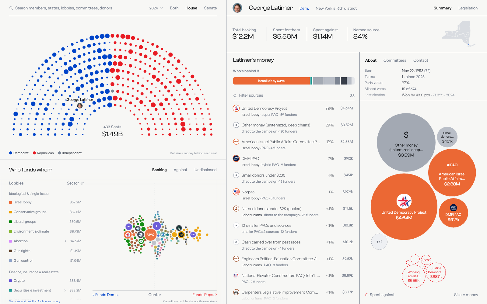

# PoliTracker: Who Funds Congress?

> **In development.** Covers the 2024 cycle today; more election cycles and more data sources are planned.

Where the money behind every member of the 119th Congress came from in the 2024 cycle, traced through PACs, super PACs
and party committees to its original donors, next to what those donors lobby for and how the member voted.

## What it shows

- **Seat chart:** every member, ordered by voting record, sized by backing or by one lobby's share.
- **Who funds whom:** the biggest funders, placed by who they fund, colored by lobby.
- **Right-side panel:** a page for any member, committee, organization, lobby or $100K+ donor, showing who funds whom,
  lobbying, bills and votes.
- **Transparency:** a "How this works" guide on first visit, and a record of how each donor was identified.

## How it works

| Step | What |
|---|---|
| 1. Load | FEC bulk files (about 60M rows); gaps filled from openFEC and raw e-filings |
| 2. Clean | Drop duplicates, memos and conduit pass-throughs; refunds negative; one ID per organization |
| 3. Match donors | Rule-based record linkage, checked against Stanford DIME donor IDs |
| 4. Trace | Proportional attribution through committees, up to 4 hops, every dollar conserved |
| 5. Tag sources | Mark each traced dollar: named person, small donors, undisclosed group, carry-over |
| 6. Classify | Industry and lobby labels; employer labels kept only if they match an independent list 85%+ of the time |
| 7. Join | Lobbying (LDA), votes (Voteview), bills (congress.gov), IRS 990s, SEC |
| 8. Verify | 20 automated checks against FEC totals and the previous build; failures block publishing |
| 9. Export | Page data; the online version names only confirmed $100K+ donors |

## Sources

FEC (bulk data, openFEC, e-filings) · Senate LDA · Voteview · congress.gov · congress-legislators · IRS · SEC EDGAR ·
GLEIF · Wikidata · LittleSis · Stanford DIME · MIT Election Lab · House Clerk · Alaska Division of Elections · Census ·
Center for Effective Lawmaking. Full list with terms: [`SOURCES.md`](SOURCES.md).

## Stack

Python, DuckDB, pandas, PyArrow, SciPy, igraph · D3 (static site) · 205 tests, ruff.

## AI use

Claude Code was used as a coding assistant to write code for the pipeline and dashboard. A model (Claude Opus 5.5) also suggested
industries for the 3,462 largest employers (e.g. Google → tech). Those suggestions were checked against an independent
industry list, and only the groups that matched were kept (85%+ agreement). No model decides whether two donor
records are the same person: merges follow written rules checked against Stanford DIME.

## Data use

FEC contributor data may not be used to solicit contributions or for commercial purposes (52 U.S.C. 30111(a)(4)).
No donor addresses or contact details are published.

## Code

The source code isn't public yet; it will be published later. © 2026 PoliTracker. All rights reserved.
